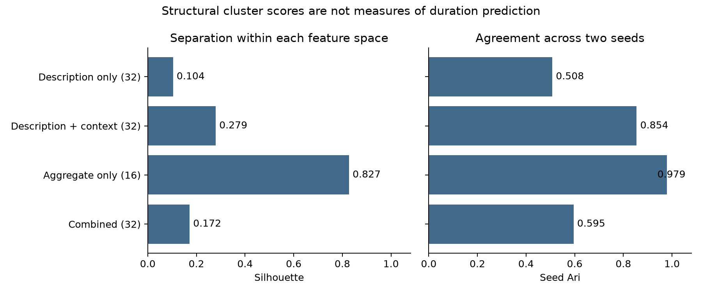
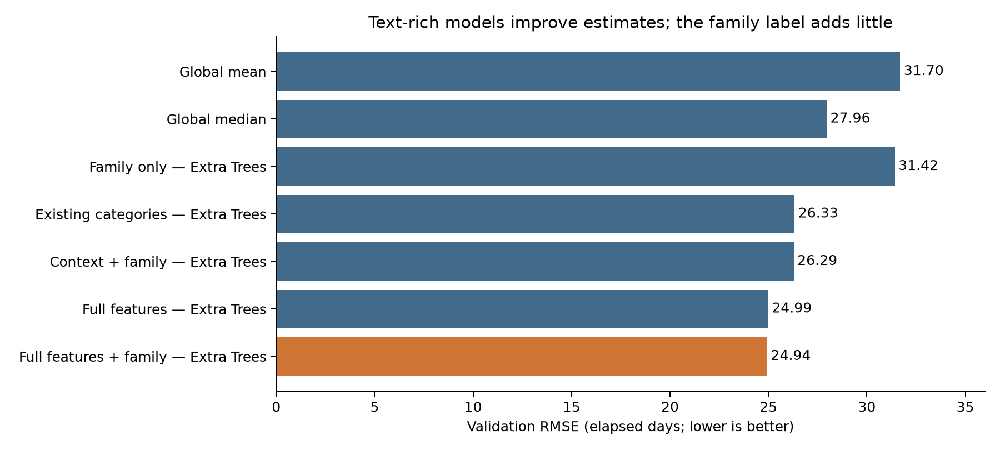
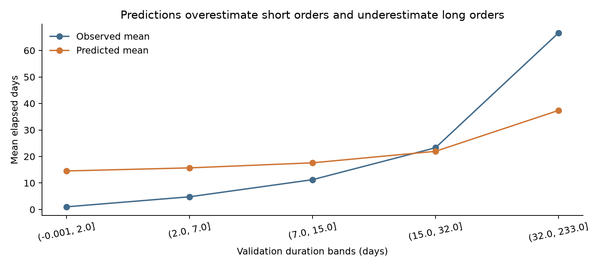

# FMUCD: task families and duration prediction

> **Current code versus recorded results:** The latest text construction removes the added Work/System/Subsystem/Component labels. The completed runs analyzed below used the earlier labeled text. The updated text has not yet been rerun.

Project report · October 25, 2026

## Main findings

We used public maintenance records to build and evaluate a description-to-family-to-prediction workflow. The question was whether grouping similar work could help estimate duration when exact task histories are sparse.

The strongest saved model was **Extra Trees using full features plus a context-text family label**. On 10,000 validation orders, it achieved **RMSE 24.94 days, MAE 15.52 days, and R² 0.178**. Its MSE was 20.4% below the global-median baseline. However, adding the family label to the same full-feature model reduced MSE by only **0.4%**. Most of the improvement was already present in the model using text and context directly.

Clustering produced recognizable examples and repeatable groups, especially when classification context was included. The strongest geometric scores came from aggregate profiles, but those groups also reflected missing data and university-specific patterns. High cluster separation did not establish that a family was useful for prediction.

**These are validation findings.** No completed final-test evaluation is recorded in the saved artifacts. We should describe the selected model as the best validation candidate, not as a test-validated production model.

## What we did in the four notebooks

| Notebook | Work completed | Why we did it |
| --- | --- | --- |
| `data_exp.ipynb` | Checked records, missingness, dates, duration, institutional differences, repeated descriptions, and time patterns. Created task-level and work-order-level datasets. | Establish a defensible target and population before comparing algorithms. |
| `embedding.ipynb` | Created two 128-dimensional text representations using TF-IDF and SVD: work description alone, and description with classification context. | Test whether context adds useful similarity information and start with a reproducible local baseline. |
| `clustering.ipynb` | Compared four representations and 8, 16, and 32 K-means families, with two seeds per candidate. Saved assignments and representative tasks. | Compare separation, balance, stability, interpretability, and assignment coverage without using duration. |
| `modeling.ipynb` | Compared five simple baselines and 18 learned models across six feature sets. Examined validation errors by university and task history. | Separate the value of text, existing classifications, and learned family labels. |

The saved results use the `tfidf_review`, `families_review`, and `duration_pilot` runs. The optional sentence-transformer and ANN paths were **not used** in these runs. Earlier introductory notebook text still describes drafts; this report uses the executed code, saved manifests, assignments, and metric files as the evidence of completed work.

## 1. Data exploration and preparation

### Population and target

The source contains **3,731,442 rows, 38 fields, and 12 universities**. We removed **482,545 exact duplicate rows**, leaving **3,248,897** records for the remaining checks. A repeated university/order ID was treated as ambiguous rather than automatically choosing one conflicting record.

We chose `WODuration`, the elapsed time between recorded start and end dates, as the target. It is useful for a process-duration experiment, but it includes potential waiting, scheduling, and administrative closure. It does not measure hands-on work or engineering standard hours.

The distribution is strongly skewed. Among nonnegative recorded durations, the median is **14 days**, the 90th percentile is **86 days**, and the 99th percentile is **369 days**. About **42.3% of deduplicated rows** lack a recorded duration. Building area and use are missing from **88.48% of raw rows**. These percentages use different populations and should not be interchanged.

### Cleaning decisions

We kept orders with a nonnegative duration, a nonblank work description, an unambiguous university/order key, and valid dates agreeing with recorded duration to within one day. The date tolerance allows for differences between fractional elapsed days and day-level recording. Long durations were not removed using an arbitrary upper cutoff.

The exclusion audit applies the first matching reason, so these counts do not overlap:

| Disposition after exact deduplication | Rows |
| --- | ---: |
| Included in prepared modeling datasets | 1,510,811 |
| Missing or invalid duration | 1,373,390 |
| Repeated university/order ID | 276,322 |
| Outcome unavailable at the relevant split cutoff | 57,703 |
| Missing or inconsistent dates | 29,358 |
| Missing university/order ID | 816 |
| Missing description | 497 |

These rules improve consistency but narrow the population. The retained records represent about **40.5% of the original rows**. The results therefore apply to the prepared completed-order population, not automatically to all incoming work.

### Text and task definitions

We retained two text fields:

- **Description only:** `WODescription`.
- **Description with context:** work description plus `SystemDescription`, `SubsystemDescription`, and `ComponentDescription`, separated by field labels.

For grouping, we normalized case and whitespace while retaining numbers and maintenance intervals. A task was defined as the normalized description plus its system, subsystem, and component codes. This is a working identity for the experiment; it is not a verified physical asset or material number.

About **86.8% of normalized descriptions appear once**. The training export contains **467,618 distinct tasks**, and **96.84%** have one observation under the description-plus-code definition. This supports testing information sharing between different descriptions. It also means that exact-history estimates will be sparse for many tasks.

### Chronological evaluation

| Split | Prepared orders | Boundary |
| --- | ---: | --- |
| Training | 1,065,435 | Starts before March 25, 2019; completion also known before that date |
| Validation | 209,488 | Starts March 25–November 19, 2019; completion known before November 20 |
| Test | 235,888 | Starts on or after November 20, 2019 |

We used chronological boundaries to resemble prediction of later orders from earlier information. Completed duration was available before each development cutoff. This avoids learning from later completions, but excludes slow orders still open at a cutoff. That completion-based selection is a limitation, not a guarantee that the evaluation fully represents deployment.

Costs, labor hours, completion dates, and duration summaries were excluded from initial-duration predictors. Condition assessments and observed weather were not default predictors because their availability at prediction time was uncertain.

## 2. Text representations

The completed run used **TF-IDF with word unigrams/bigrams**, a maximum vocabulary of 30,000 features, sublinear term frequency, **128-dimensional truncated SVD**, and L2 normalization. The vocabulary and SVD were fitted separately for the two variants on the same **20,000 training tasks**. The fitted transformations were then applied to the full catalog of **607,391 tasks**, including later unseen tasks.

This was a practical first comparison: it runs locally, has no paid API requirement, and separates representation quality from a large pretrained model. It is a **lexical embedding baseline**, not a completed test of a contextual semantic encoder.

Description-only text produced **299 zero vectors** across the catalog, including 236 training tasks. The context variant produced none. Common classification wording provides usable vocabulary for otherwise sparse descriptions, but a nonzero vector alone does not establish useful similarity.

Only a sample of training tasks informed vocabulary/SVD fitting. Rare terminology can be missed, and SVD may remove details important to a particular maintenance operation. These are reasons to compare larger fit samples and semantic encoders later.

## 3. Clustering results

We compared MiniBatch K-means using description vectors, context vectors, numeric aggregate profiles, and a combination of context vectors and profiles. Numeric profiles included observed task counts, university/building coverage, PPM share, building-size/age summaries, and missingness indicators. We used median imputation, scaling, and row normalization before combining blocks with equal weight.

Centroids were fitted on up to **50,000 training tasks**. Silhouette and seed agreement were measured on samples of up to **2,000** fitted training tasks. Duration did not determine the clusters or their selection.

| Representation | Selected families | Silhouette | Seed agreement (ARI) | Assigned tasks in catalog |
| --- | ---: | ---: | ---: | ---: |
| Description only | 32 | 0.104 | 0.508 | 607,092 |
| Description + context | 32 | 0.279 | 0.854 | 607,391 |
| Aggregate only | 16 | 0.827 | 0.979 | 467,618 |
| Combined context + aggregates | 32 | 0.172 | 0.595 | 467,618 |

The selection rule favored the highest silhouette among candidates with no empty clusters. Aggregate-only clustering at 32 families had a slightly higher silhouette, **0.833**, but one empty cluster, so 16 was selected. The other methods selected the largest value tried; we have not established that 32 is an optimal family count.

Silhouette describes geometry within a representation. Scores from differently constructed feature spaces should not be read as a direct ranking of operational or predictive value. ARI here compares two random seeds, not ground-truth family labels or independent data samples.

### What the families capture

**Classification context improved separation and seed stability over description text alone.** Representative context-text tasks included elevator faults, door/frame adjustment, lighting complaints, and HVAC belt changes. These examples are recognizable, but the selected representatives come from the fit sample and have not been formally validated by maintenance experts.

An additional audit found normalized mutual information of **0.795** between context-text families and existing component codes, compared with **0.254** for description-only families. This is consistent with the context variant recovering much of the supplied hierarchy. Because component descriptions were deliberately included in its input, that alignment is **not independent validation of newly discovered process structure**.

**Aggregate-only clustering is stable but heavily influenced by the available profile structure.** There are only **5,860 distinct numeric profiles** among 467,618 training tasks. About **72.47% of task profiles** lack a median building-size value, and most tasks have one observation. The largest aggregate family contains **39.8% of training tasks**; its members all lack building-size information and have UPM rather than PPM records. Aggregate families also have substantially more association with university identity than context-text families: NMI **0.582 versus 0.100**, measured on tasks observed at one university.

These diagnostics point to grouping by data availability and institutional practice as well as work characteristics. More than one factor can produce a clean geometric separation.

**Adding the numeric block did not improve the context-text solution under the tested weighting.** Its silhouette and seed agreement were lower. This does not rule out useful aggregate information; it identifies a need to reconsider the features and weighting.

### Coverage for new work

Aggregate and combined profiles exist only for training tasks. They cannot assign the **139,773 later-only task identities** without inventing future history, so those tasks remain unassigned. Text methods can assign later tasks using fixed text transformations.

The modeling pilot used the **32-family context-text solution**. The other three cluster representations were not compared in the downstream duration-model experiment. We should not claim their predictive value from their structural scores alone.

## 4. Model comparison and selected candidate

### Design and rationale

We sampled **25,000 training orders** and **10,000 validation orders**, using seed 42. That is approximately 2.35% and 4.77% of the prepared splits. Every candidate used the same records. This kept the first experiment manageable and made the feature comparisons consistent, but it remains a bounded pilot.

The six feature sets were context alone; context plus existing classifications; family only; context plus family; full features; and full features plus family. Context includes university, priority, maintenance type, building use/size/age, and start-date features. Full features add the existing classification codes and 128 context-text dimensions.

Numeric predictors were median-imputed and scaled. Categorical variables were one-hot encoded, pooling infrequent levels. Family IDs were categorical. The learned models were ridge regression (`alpha=10`), a decision tree (`max_depth=8`, `min_samples_leaf=25`), and an Extra Trees ensemble (80 trees, depth 20, minimum leaf size 10). The optional ANN was disabled. This was a representation comparison with fixed initial settings, not an extensive hyperparameter search.

We selected by MSE to match the original objective. RMSE and MAE express error in days; R² describes explained variation. Targets were untransformed, predictions were clipped at zero, and no target-based upper trimming was applied.

### Validation results

| Candidate | MSE (days²) | RMSE (days) | MAE (days) | R² |
| --- | ---: | ---: | ---: | ---: |
| Global training mean | 1,004.61 | 31.70 | 27.77 | −0.328 |
| Global training median | 781.94 | 27.96 | 17.99 | −0.033 |
| Family only — Extra Trees | 987.42 | 31.42 | 26.56 | −0.305 |
| Existing classifications + context — Extra Trees | 693.35 | 26.33 | 15.53 | 0.084 |
| Context + family — Extra Trees | 691.05 | 26.29 | **15.00** | 0.087 |
| Full features — Extra Trees | 624.57 | 24.99 | 15.53 | 0.175 |
| Full features + family — Extra Trees | **622.08** | **24.94** | 15.52 | **0.178** |

The selected candidate reduced MSE by **38.1% relative to the global mean**, **20.4% relative to the global median**, and **10.3% relative to the existing-classification Extra Trees model**. These are validation comparisons, not causal effects or final-test estimates.

The key family ablation is much smaller: **624.57 to 622.08 MSE**, a **0.399% reduction**, or about **0.05 days in RMSE**. MAE changes by less than 0.01 day. We do not have repeated-window or paired uncertainty estimates establishing that this small gain is reliable.

The family label is derived from inputs already available to the full model, so it adds a representation, not an independent information source. Family-only models performed poorly, and the effect of adding a family was not consistent across learners: the full decision tree was unchanged, while full ridge MSE increased from **766.08 to 775.98**. Extra Trees was the strongest tested model class, but these fixed settings do not establish that ridge or other learners could never work well.

The lowest MAE belonged to **context + family Extra Trees**, not the MSE-selected candidate. If typical scheduling error matters more than large misses, model selection should reflect that operational objective.

### Where the model struggles

| Validation population | Orders | RMSE (days) | MAE (days) | R² |
| --- | ---: | ---: | ---: | ---: |
| Tasks present in training | 5,795 | 24.57 | 14.81 | 0.255 |
| Tasks absent from training | 4,205 | 25.45 | 16.50 | −0.032 |

The model explained little within-group variation for unseen task identities. That R² uses the unseen subset's own mean as its reference; it is not itself a comparison with a deployable unseen-task baseline. An unseen identity can still have wording close to a training task, so this is not a strict test of entirely novel kinds of work.

Known tasks with one to nineteen training observations account for only **329 validation orders**. Although the discovery dataset contains many singleton tasks, the work-order-level validation sample is dominated by common tasks and unseen identities. Claims about rare known work need more targeted evaluation.

Institutional performance also varies. Validation MAE ranges from **11.59 to 25.67 days**, and four of the eight represented universities have negative within-university R². University 10 contributes **41.61%** of the validation sample. Overall metrics therefore conceal important differences in reporting practices and population mix.

The median absolute error is **9.61 days** and the 90th-percentile absolute error is **34.03 days**. Average bias is small, at +0.30 day, but that average masks opposing errors. The longest-duration validation group—**1,010 orders of at least 61 days**—accounts for **62.8% of squared error** and is underpredicted by about **44.1 days on average**.

The sampled training mean is **36.76 days**, compared with **21.02 days** in validation. Their medians are 16 and 10 days. This shift helps explain why the global training mean performs poorly. A fair practical comparison needs strong time-aware and institution-aware baselines, not only that global mean.

## 5. Limitations and what we can claim

We can show a reproducible workflow, compare representations, and measure validation prediction error. We cannot yet claim that these families improve estimates reliably, that they represent true manufacturing families, or that the method will outperform engineering standard hours in a factory.

The main limits are:

1. **Target mismatch.** Elapsed maintenance duration includes waiting and closure behavior. It is not the labor-hour or standard-hour target of the original manufacturing application.
2. **Selection and missingness.** Missing targets, ambiguous order IDs, and completion-based cutoffs remove much of the source population. Slow unfinished orders may be underrepresented near boundaries.
3. **Text provenance.** Creation-time descriptions are not verified. Later edits could reveal information unavailable when a prediction would have been made. Task definitions can also retain location or equipment-specific identifiers.
4. **Sparse and administrative aggregate features.** Most training tasks have one observation, many building values are missing, and numeric profiles strongly reflect institutional patterns.
5. **Circular evidence from existing classifications.** Context includes the classification descriptions, and the strongest text clusters resemble those codes. A separate expert review is needed to establish additional process meaning.
6. **Limited comparison scope.** Only one family representation reached modeling; only one cluster algorithm, three cluster counts, one pilot sample, and fixed model settings were evaluated. Semantic encoders and ANN performance were not tested.
7. **Limited evidence for the incremental family effect.** The best gain over full features is 0.4% MSE, without uncertainty estimates. Separate predictions for the full-feature comparator were not saved, limiting a retrospective paired assessment of that gain.
8. **No recorded final-test result.** The model manifest says `test_evaluated=false`, and no locked-test score file is present. The test configuration being enabled in notebook code is not evidence that evaluation completed.

Training-only fitting, explicit joins, separate outcomes, and file fingerprints reduce several leakage and alignment risks. They do not resolve the source-data and evaluation limitations above.

## 6. Future work, in priority order

**Complete the locked comparison.** Before opening the final test, specify the selected full-plus-family candidate, its same-model full-feature comparator, and strong simple baselines. Comparing only with the global mean will not isolate the family contribution. Save all paired predictions and report sample sizes and assignment coverage.

**Check robustness over time and task novelty.** Use rolling chronological windows, rebuilding embeddings, aggregate profiles, and clusters within each window. Add a task-held-out experiment and, where possible, a template-held-out experiment. Estimate uncertainty using paired resampling that respects recurring tasks and institutional structure.

**Test the target closest to the manufacturing question.** Repeat the pipeline for `LaborHours` after auditing its quality. If dates support it, distinguish queue time from actual execution time. This will make the public proof of concept more relevant to work-content and standard-hour estimation.

**Improve and compare the text inputs.** Run a pretrained sentence encoder, vary the TF-IDF fit sample, and inspect tokenization of technical numbers and units. Compare descriptions with and without classification text and removable location/asset tokens. Keep these decisions based on training/validation evidence.

**Improve family validation and numeric profiles.** Ask a domain expert to review representative members and near misses. Compare an additional clustering method and a broader family-count/weight grid. Test removing missingness-dominated features and add true pre-work process information when available. Treat far-from-centroid tasks as uncertain rather than forcing every new task into a family.

**Strengthen the predictive benchmark.** Evaluate an uncapped training run, partial-pooling historical baselines, robust or log-target alternatives, and prediction intervals. Compare MAE and tail error alongside MSE. Choose the error measure that matches the scheduling decision.

**Validate transfer to manufacturing.** Use authorized factory data with creation-time engineering descriptions, quantities, routings, actual labor, and current estimates. A public maintenance result supports method development; factory performance requires its own temporal and rare-material validation.

## A ten-minute presentation

| Topic | Time | Point to make |
| --- | ---: | --- |
| Problem and hypothesis | 1 minute | Sparse exact histories motivate grouping similar work. |
| Data and target | 1.5 minutes | Explain elapsed duration, missing outcomes, and the chronological split. |
| Text and families | 2 minutes | Show context versus description-only clustering and a few examples. |
| Model results | 2.5 minutes | Full features help; adding families gives only a small incremental gain. |
| Errors and limitations | 2 minutes | Show unseen-task performance, long-order misses, and the lack of final-test evidence. |
| Next experiment | 1 minute | Lock the comparison, test it once, and repeat for labor hours. |

The central conclusion is: **we found useful predictive signal in text and context, but have not yet shown that compressing that information into family labels provides a dependable additional benefit.**

## Evidence and reproducibility

The report was prepared from saved results without refitting the models or opening test outcome rows. Source and artifact fingerprints were verified across the exploration, embedding, clustering, and modeling stages. Saved best-model validation predictions reproduce its reported MSE and MAE.

- [Exploration manifest](../data/clustering/manifest.json), [target quality](../data/clustering/target_quality.csv), [field quality](../data/clustering/field_quality.csv), and [split summary](../data/clustering/split_summary.csv).
- [Embedding manifest](../data/embeddings/tfidf_review/manifest.json).
- [Family manifest](../data/families/families_review/manifest.json), [candidate scores](../data/families/families_review/candidate_scores.csv), and saved task assignments/representatives.
- [Modeling manifest](../data/modeling/duration_pilot/manifest.json), [validation scores](../data/modeling/duration_pilot/validation_scores.csv), [validation slices](../data/modeling/duration_pilot/validation_slices.csv), and saved validation predictions/training IDs.
- [Additional report calculations](evidence/report_metrics.json) and [cluster profiles](evidence/cluster_profiles.csv). NMI, profile duplication, and tail-error diagnostics are report analyses of saved artifacts, not additional model-selection experiments.

The recorded execution environment was NumPy 1.26.4, pandas 2.1.4, and scikit-learn 1.3.2. The original data source is Pampana et al. (2024), *Facility Management Unified Classification Database*, Mendeley Data V1, [doi:10.17632/cb8d2nsjss.1](https://doi.org/10.17632/cb8d2nsjss.1), licensed CC BY 4.0. See the [dataset paper](https://doi.org/10.1016/j.dib.2024.110845) for collection methods and original definitions.
